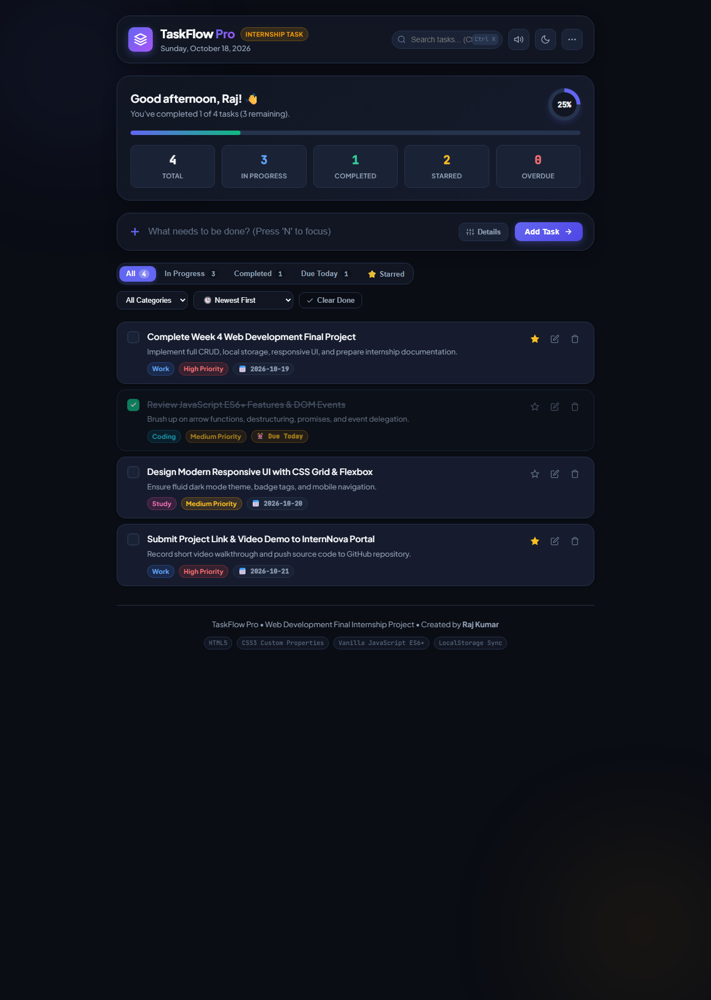

# TaskFlow Pro — Fully Functional To-Do List Web Application

A modern, responsive, and feature-rich To-Do List web application built for the **Web Development Internship Final Task** (InternNova).




---

## 🌟 Overview & Key Features

TaskFlow Pro is engineered from scratch using clean vanilla HTML5, modern CSS3 (Custom Properties & Glassmorphism), and pure ES6+ JavaScript. It requires **no frameworks, no external libraries, and no build tools**—it runs straight out of the box in any browser.

### 📋 Core Functionality (CRUD)
- **Create**: Add tasks instantly with the main input bar or expand details to assign a **Category**, **Priority level**, **Due Date**, and **Notes/Checklists**.
- **Read & Display**: Clean task cards with dynamic priority tags, category badges, due date countdowns, and notes.
- **Update**: Edit any task inline or through the full **Edit Modal** (`title`, `notes`, `category`, `priority`, `dueDate`, `starred`).
- **Delete**: Instant deletion with smooth animations and an **Undo button** in the toast notification to restore accidental deletions.
- **Toggle Completion**: Mark tasks as done or in-progress with animated checkboxes, strikethrough text, and audio cues.

### 🎯 Organization, Filtering & Sorting
- **Status Tabs**: Easily switch between **All**, **In Progress**, **Completed**, **Due Today**, and **⭐ Starred** tasks.
- **Real-Time Live Search**: Instant search matching task titles, descriptions, and categories with keyboard shortcut (`Ctrl + K`).
- **Category Filter**: Filter tasks by *Work & Internship*, *Coding & Tech*, *Study*, *Personal*, or *Health*.
- **Sorting Options**: Sort by *Newest First*, *Oldest First*, *Highest Priority*, *Due Date (Earliest)*, or *Alphabetical (A–Z)*.
- **Bulk Actions**: "Clear Completed" and "Delete All" with confirmation safeguards.

### 📊 Productivity Dashboard & Analytics
- **Live Progress Metric**: Dynamic circular progress badge and linear gradient bar tracking completion rate (0% to 100%).
- **Interactive Counters**: Real-time counts for Total, In Progress, Completed, Starred, and Overdue tasks (clicking any counter instantly filters the list).
- **Personalized Header**: Dynamic greeting (*Good morning / afternoon / evening, Raj!*) and current date display.

### 🎨 Design & Experience (UX / UI)
- **Dark & Light Mode**: Seamless theme switching with persistent user preference stored in `localStorage`.
- **Sound Feedback**: Pleasant synthetic audio feedback (Web Audio API) for adding, completing, and deleting tasks (toggleable on/off).
- **Responsive Layout**: Designed for mobile phones, tablets, laptops, and ultra-wide desktops.
- **Data Backup & Restore**: One-click **Export to JSON** and **Import from JSON** for backups.
- **Sample Tasks**: Pre-loaded realistic sample tasks for instant evaluation and testing.

---

## 🚀 How to Run the Project

No setup, Node.js, or server installation is required.

1. **Option 1: Direct Browser Launch**
   - Double-click `index.html` to open it directly in Google Chrome, Microsoft Edge, Mozilla Firefox, or Safari.

2. **Option 2: Using VS Code Live Server (Recommended)**
   - Open the `proj` folder in VS Code.
   - Right-click `index.html` and select **"Open with Live Server"**.
   - The application will run at `http://127.0.0.1:5500/index.html`.

3. **Option 3: Using Python Local Server**
   ```bash
   python -m http.server 8000
   ```
   Open `http://localhost:8000` in your web browser.

---

## ⌨️ Keyboard Shortcuts

| Shortcut | Action |
| :--- | :--- |
| `Ctrl + K` / `Cmd + K` | Focus search bar |
| `N` | Jump to "New Task" input field |
| `Enter` | Submit / Add task |
| `Escape` | Close edit modal or blur search |

---

## 📁 Project Structure

```
proj/
├── index.html        # Semantic HTML5 layout, accessible modal, header & stats
├── style.css         # Modern styling, dark/light themes, animations, responsive queries
├── script.js         # State management, LocalStorage sync, audio tones, filter/sort engine
└── README.md         # Comprehensive project documentation & submission guide
```

---

## 📝 Internship Submission Guidelines (InternNova)

1. **GitHub Repository**:
   - Initialize git: `git init`
   - Stage files: `git add .`
   - Commit: `git commit -m "Complete fully functional To-Do website task"`
   - Push to your GitHub account (public repository).
2. **Live Deployment**:
   - Deploy free to **GitHub Pages**, **Netlify**, or **Vercel** with one click.
3. **Submission Form**:
   - Submit your **GitHub Repo URL** and **Live Deployment URL** in the internship portal.

---
**Author**: Raj Kumar  
**Project**: Web Development Internship — Final Task
